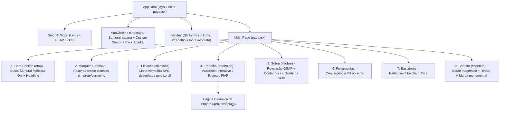

# Especificação Técnica — Portfólio Samurai Dark (Renan Xavier)

## 1. Visão Geral e Propósito

Construir o portfólio profissional de alta performance para **Renan Santa Rosa Xavier**, inspirado na arquitetura, fluidez e acabamento visual do site de referência `https://carlos-abucci.vercel.app/`.

O projeto combina uma estética visual refinada em **Preto e Vermelho Carmesim** com a temática **Samurai / Máscara Oni**, incorporando animações cinemáticas acionadas por scroll, preloader interativo com corte de katana e divisão de folha, e páginas dedicadas para os 7 projetos desenvolvidos ao longo do curso de Análise e Desenvolvimento de Sistemas (FIAP) e projetos autorais.

---

## 2. Identidade Visual e Paleta de Cores

- **Fundo Principal (Paper Dark):** `#050505` e `#0a0a0a` (preto profundo).
- **Superfícies de Cartões / Modais:** `#121212` com bordas sutis em `#27272a` (zinc-800) e destaques em `#3f3f46`.
- **Cor de Destaque Primária (Carmesim / Sangue Samurai):** `#dc2626` e `#ef4444`.
- **Cor de Destaque Secundária (Glow / Sombra de Lâmina):** `rgba(220, 38, 38, 0.25)` a `rgba(239, 68, 68, 0.4)`.
- **Tipografia:**
  - Títulos: Fonte sem serifa moderna de alta legibilidade e peso marcante (`Plus Jakarta Sans` ou `Geist Sans`).
  - Tags, metadados e contadores: Fonte monoespaçada técnica (`Geist Mono` ou `JetBrains Mono`).
  - Cores de Texto: `#f4f4f5` (ink / texto primário) e `#a1a1aa` (ink-soft / texto secundário).

---

## 3. Arquitetura de Componentes e Fluxo da Aplicação



---

## 4. Detalhamento das Seções

### 4.1. AppChrome: Preloader Samurai & Cursor

1. **Samurai Katana Preloader:**
   - Tela preta cheia com logotipo/marca em vermelho e texto em caixa alta: `RENAN SANTA ROSA XAVIER`.
   - Contador percentual numérico de `0%` a `100%` com easing acelerado.
   - Ao atingir `100%`:
     - Um rastro brilhante de lâmina katana (feixe laser vermelho carmesim e branco com partículas de corte) corta diagonalmente a tela.
     - A tela se divide em duas metades diagonais através de `clip-path` do CSS/Framer Motion.
     - As duas metades da página cortada se inclinam e caem simulando gravidade (efeito de folha cortada ao meio), revelando a seção `Hero`.
   - Persistência: suporte a `sessionStorage` para não travar navegações repetidas durante testes, com botão ou mecanismo de re-execução.
2. **Cursor Interativo Magnético:**
   - Ponto com anel vermelho reativo às coordenadas do mouse (`window.mousemove`).
   - Ao passar sobre elementos clicáveis (`a`, `button`, `.cursor-target`), expande suavemente com glow carmesim (`data-grow="1"`).
   - Efeito de faíscas ao clicar (`click sparks`) nas cores branca e vermelha.

### 4.2. Hero Section (`#top`)

- **Busto do Samurai com Máscara Oni:**
  - Exibição gráfica vetorial detalhada (SVG responsivo / Canvas estilizado) posicionado estrategicamente na seção Hero: silhueta sombria dos ombros para cima, quimono escuro com contornos em vermelho e a máscara de Oni demoníaca tradicional japonesa com presas afiadas, chifres sutis e olhos com brilho carmesim pulsante.
- **Tipografia e Entrada:**
  - Categoria superior monoespaçada com entrada staggered: `DESENVOLVEDOR FULL STACK — RIO DE JANEIRO, RJ`.
  - Headline monumental:
    ```
    Construo sistemas
    full stack
    do banco ao pixel.
    ```
  - Parágrafo descritivo:
    *"Estudante de Análise e Desenvolvimento de Sistemas na FIAP (RM566997). Experiência prática na construção de APIs robustas em Spring Boot, aplicações web reativas, ferramentas desktop nativas e automações inteligentes."*
  - Ação rápida: Botão com seta descendente animada `"Rolar para ver o trabalho"` e indicador pulsante verde/vermelho `"Disponível para novos projetos / estágio"`.

### 4.3. Marquee Paralaxe de Tecnologias

- Duas linhas horizontais opostas de texto dinâmico controladas pelo scroll e velocidade da física via `useSpring` e Framer Motion/GSAP:
  - Linha 1 (Vermelho e Branco): `JAVA · SPRING BOOT · REACT · ORACLE SQL · DOCKER · TYPESCRIPT ·`
  - Linha 2 (Bordas Vazadas / Outline): `ARQUITETURA · SEGURANÇA · DESEMPENHO · PRODUTO · AUTOMAÇÃO ·`

### 4.4. Filosofia & Stroke de Katana (`220vh`)

- Seção sticky que prende o texto no centro da tela enquanto o usuário rola:
  - Título: *"O traço que segue o seu scroll, como a lâmina segue a intenção."*
  - Subtítulo: *"Cada linha de código tem um propósito. Continue rolando."*
  - SVG de alta fidelidade desenhando um rastro sinuoso vermelho carmesim que se preenche gradativamente de `0` a `1` (`pathLength` vinculado ao `scrollYProgress`).

### 4.5. Trabalho Selecionado (`#trabalho`)

- Contador de cabeçalho: `Trabalho selecionado (7)`.
- Lista interativa com efeito hover accordion:
  1. **`01` — ESG Spring API** (2026): *Back-end & Arquitetura* — API RESTful em Java 21 & Spring Boot 3 para controle de emissões de carbono de Escopo 3, auditoria Flyway, Spring Security e Docker.
  2. **`02` — Drawer: Windows Organizer** (2026): *Desktop & Sistemas* — Organizador de ícones para Área de Trabalho do Windows estilo gavetas do Discord em Electron, Node.js e C# Win32 Native.
  3. **`03` — BestSign: Assinatura PDF** (2026): *Mobile & Segurança* — Aplicativo nativo Android em Kotlin 2.0 & Jetpack Compose com autenticação biométrica, assinatura manual em Canvas e manipulação de PDFs com PDFBox.
  4. **`04` — Trivus Bank: Fintech Acessível** (2025): *Full-stack & Acessibilidade* — Ecossistema de banco digital educativo focado em idosos, com backend Spring Boot, frontend React e persistência Oracle JDBC.
  5. **`05` — CAREinho: Jornada do Cuidado** (2025): *Front-end & Produto* — Plataforma gamificada para combate ao absenteísmo em consultas médicas com React 18, Vite, Tailwind CSS e modelagem Oracle.
  6. **`06` — Automação ESG & IoT em PL/SQL** (2026): *Banco de Dados & Automação* — Solução automatizada no Oracle Database com triggers de resposta imediata a sensores IoT prediais e eficiência energética.
  7. **`07` — SkillHub: Global Solution FIAP** (2025): *Modelagem & UI/UX* — Plataforma de avaliação de competências técnicas/comportamentais com modelagem relacional completa e protótipos de alta fidelidade.
- Ao clicar em qualquer item, navega para a página individual do projeto em `/projetos/[slug]`.

### 4.6. Páginas de Projeto (`/projetos/[slug]`)

- Rota dinâmica com carregamento baseado no slug.
- Cabeçalho com botão `"← Voltar para projetos"` com efeito magnético.
- Hero da página de projeto com gradiente radial carmesim escuro, índice numérico, título, categoria, ano, papel e link direto para o repositório no GitHub (`github.com/Renan-Xavier/...`).
- Blocos de conteúdo técnico:
  - **Visão Geral / Overview:** Descrição aprofundada da proposta de valor.
  - **Destaques Técnicos:** Lista de 3 a 5 pontos fortes de engenharia, arquitetura e segurança.
  - **Desafio & Resultado:** Comparação direta em grid de duas colunas.
  - **Stack Completa:** Badges arredondadas de cada tecnologia utilizada.
- Rodapé de transição: Cartão clicável gigante direcionando para o próximo projeto da lista com seta animada `→`.

### 4.7. Sobre Mim (`#sobre`)

- Frase de apresentação com revelação palavra por palavra baseada em scroll (GSAP ScrollTrigger):
  *"Desenvolvo sistemas e produtos full stack com foco em robustez, arquitetura limpa e clareza: do modelo relacional e regras de negócio no banco à interface final do usuário, passando por autenticação segura, automações e integração contínua."*
- Contadores estatísticos animados:
  - `7` projetos autorais e acadêmicos completos
  - `15+` tecnologias dominadas
  - `4` áreas de atuação
- Grade de competências em 4 quadrantes:
  - **Back-end & Dados:** Java 21, Spring Boot 3, REST APIs, Oracle SQL, PL/SQL, Flyway, PostgreSQL, Prisma, Spring Security, Hibernate.
  - **Front-end & Mobile:** React 19/18, Next.js, TypeScript, Tailwind CSS, Kotlin, Jetpack Compose, Vite, Figma / UI/UX.
  - **Desktop & Automação:** Electron, C# Win32 Native Helper, Python 3, Playwright, BeautifulSoup, FFmpeg, Shell Scripting.
  - **DevOps & Ferramentas:** Git, GitHub, Docker, Docker Compose, Postman, Oracle Data Modeler, Android Studio, VS Code.

### 4.8. Ferramentas do Ofício (`Stack`)

- Animação sticky (`200vh`):
  - Letras tridimensionais rotacionando em perspectiva no scroll.
  - Ícones vetoriais das tecnologias centrais convergindo e se alinhando com suavidade (Java, Spring, React, TypeScript, Kotlin, Oracle, Docker, Tailwind).

### 4.9. Bastidores / Filosofia Prática

- Título: *"Código é meio. Pessoas e impacto são o fim."*
- Efeito sutil de background com canvas de partículas carmesins flutuantes.

### 4.10. Contato (`#contato`)

- Título: *"Vamos construir algo que dure."*
- Botão magnético gigante com email `rsrx14@gmail.com` e ícone que gira 45º no hover.
- Links rápidos:
  - GitHub: `https://github.com/Renan-Xavier`
  - LinkedIn: `https://linkedin.com/in/renan-xavier` (ou link correspondente)
  - Telefone / WhatsApp: `(21) 98569-2631`
  - E-mail: `rsrx14@gmail.com`
- Rodapé institucional: `Belford Roxo / Rio de Janeiro, RJ · 2026`.
- Tipografia monumental semi-transparente ao fundo: `RENAN`.

---

## 5. Estrutura de Arquivos do Projeto

```
Portfólio/
├── package.json
├── tsconfig.json
├── tailwind.config.ts
├── postcss.config.mjs
├── next.config.ts
├── public/
│   ├── brand/
│   │   ├── logo.svg
│   │   └── oni-mask.svg
│   ├── icons/
│   │   ├── java.svg
│   │   ├── spring.svg
│   │   ├── react.svg
│   │   ├── typescript.svg
│   │   ├── kotlin.svg
│   │   ├── oracle.svg
│   │   ├── docker.svg
│   │   └── tailwindcss.svg
├── src/
│   ├── app/
│   │   ├── layout.tsx
│   │   ├── page.tsx
│   │   ├── globals.css
│   │   └── projetos/
│   │       └── [slug]/
│   │           └── page.tsx
│   ├── components/
│   │   ├── chrome/
│   │   │   ├── AppChrome.tsx
│   │   │   ├── SamuraiLoader.tsx
│   │   │   └── CustomCursor.tsx
│   │   ├── hero/
│   │   │   ├── Hero.tsx
│   │   │   └── SamuraiOniIllustration.tsx
│   │   ├── layout/
│   │   │   ├── Navbar.tsx
│   │   │   └── Footer.tsx
│   │   ├── sections/
│   │   │   ├── Marquee.tsx
│   │   │   ├── Stroke.tsx
│   │   │   ├── Work.tsx
│   │   │   ├── About.tsx
│   │   │   ├── Stack.tsx
│   │   │   ├── Crowd.tsx
│   │   │   └── Contact.tsx
│   │   └── ui/
│   │       ├── Magnetic.tsx
│   │       └── AnimatedCounter.tsx
│   ├── data/
│   │   └── portfolio.ts
│   └── lib/
│       └── utils.ts
```

---

## 6. Critérios de Aceite e Verificação

1. **Preloader e Corte:** Ao abrir a página inicial, o preloader conta até 100%, executa o corte de katana vermelho/branco, divide a página em duas metades que caem com física realista e revela a seção Hero com o busto do Samurai de máscara Oni.
2. **Tema Preto e Vermelho:** Toda a interface obedece estritamente à paleta escurecida com toques carmesim e tipografia nítida de alto contraste.
3. **Navegação Completa de Projetos:** Todos os 7 projetos carregam dados reais da pasta `ADS FIAP`, possuem rotas funcionais `/projetos/[slug]` com metadados e navegação contínua ("Próximo projeto").
4. **Interatividade e Scroll:** Efeitos de scroll parallax, linha SVG de filosofia, contadores numéricos e conversão de stack 3D funcionam sem travamento ou erros de hidratação.
5. **Responsividade:** Layout testado e adaptável para telas desktop, tablets e smartphones.
